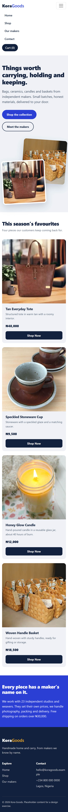
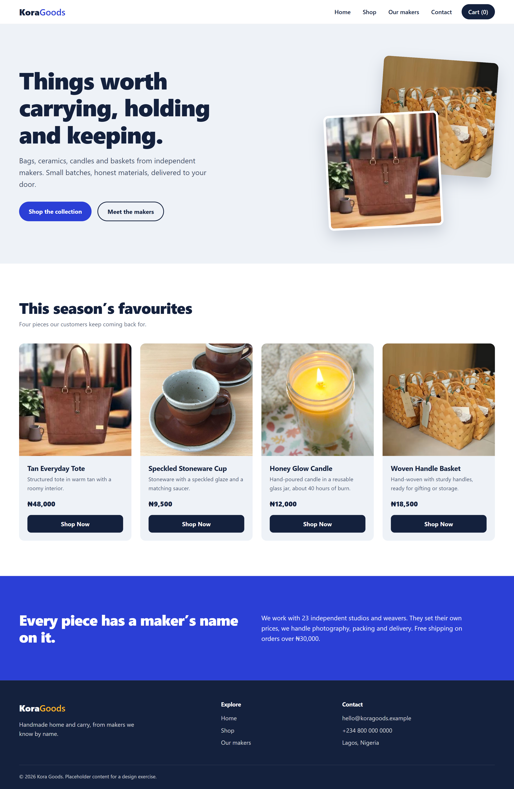
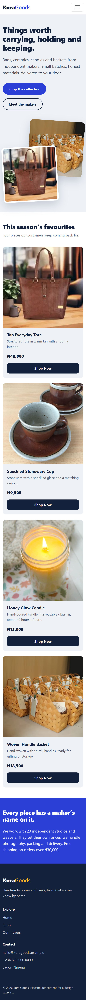
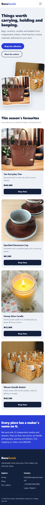

# Kora Goods: Responsive Store Landing Page

**Live demo:** https://faith-amanze.github.io/Responsive_Store_Landing_Page_Design/

A responsive landing page for a small online store selling handmade bags, ceramics, candles and baskets.
Built with HTML, custom CSS and Bootstrap 5.

## Screenshots (live page)
| Desktop (1440px) | Tablet (768px) |
|---|---|
|  |  |

| Mobile (390px) | Mobile menu open |
|---|---|
|  |  |

## Files
- `index.html`: page structure (header, hero, product section, about strip, footer)
- `styles.css`: all custom styling, commented by section
- `images/`: four product photos (JPG, cropped square and compressed)
- `Screenshots/`: desktop (1440px), tablet (768px), mobile (390px, plus menu open)

To run it locally, open `index.html` in a browser. Bootstrap loads from a CDN, so an internet connection is needed.

## Design choices
**Concept.** A small store for handmade bags, ceramics, candles and baskets. Picking a real subject gave me
believable copy, prices (in naira) and product imagery instead of generic placeholders.

**Colour.** Three working colours: deep navy for text and dark surfaces, cobalt for primary actions and the
about band, and marigold as the only warm accent (hover states, footer logo). A cool grey-blue page background
keeps the white product section distinct. All colours are CSS variables at the top of `styles.css`.

**Typography.** A system font stack (fast, no external requests) with tight letter-spacing and heavy weights
on headings. Heading sizes use `clamp()` so they scale smoothly instead of jumping at breakpoints.

**Layout.** The hero's overlapping tilted photos are the one memorable element; everything else stays quiet.
Product cards use flexbox so descriptions of different lengths still leave every "Shop Now" button aligned.

**Responsive strategy (mobile-first).**
- Products: 1 column on phones, 2 on tablets (`sm`), 4 on desktop (`xl`), via Bootstrap's `row-cols-*`.
- Navigation collapses into a hamburger menu below 768px.
- Section spacing is fluid (`clamp()`), so it tightens on small screens.
- Custom media queries adjust hero text size, card padding and hero image alignment.
- Checked at 1440, 768 and 390px with no horizontal scrolling.

**Images.** Photos are cropped square to match the cards (`object-fit: cover`), compressed to under 100 KB each,
and lazy-loaded below the hero. Every image has alt text describing what it shows.

**Library (extra points).** Bootstrap 5.3 provides the grid, collapsing navbar and button base. Custom CSS loads
after it and restyles components so the page doesn't look like default Bootstrap. The Bootstrap files use
Subresource Integrity hashes.

**Accessibility.** Skip link, visible focus outlines, alt text on every image, semantic landmarks
(`header`, `main`, `footer`), labelled nav, and reduced-motion support.

## Photo credits
Replace each line with the photographer and source before submitting (for example "Photo by NAME on Unsplash"):
- `images/tote.jpg`: 
- `images/mug.jpg`: 
- `images/candle.jpg`: 
- `images/basket.jpg`:
